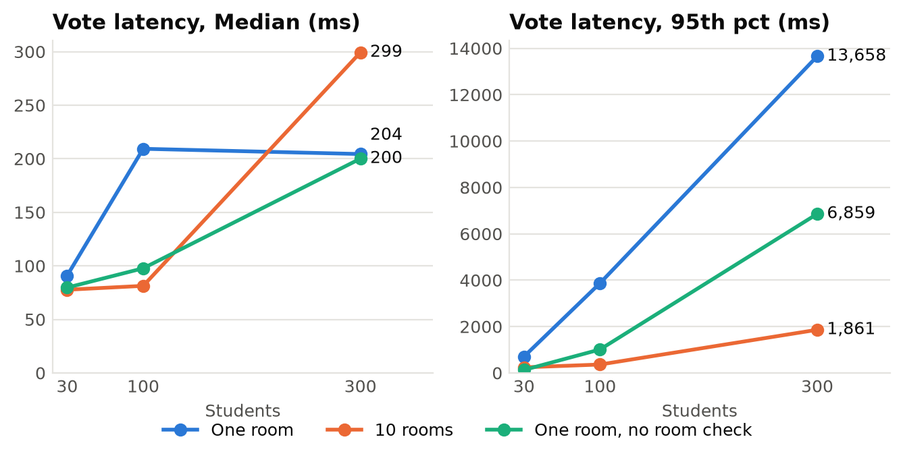
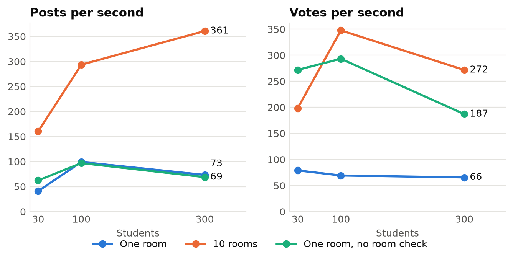
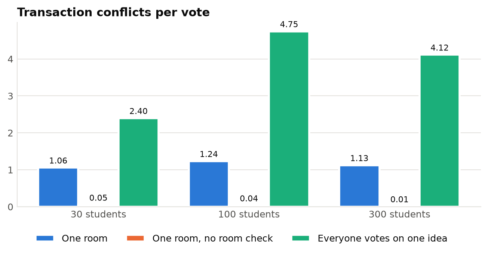
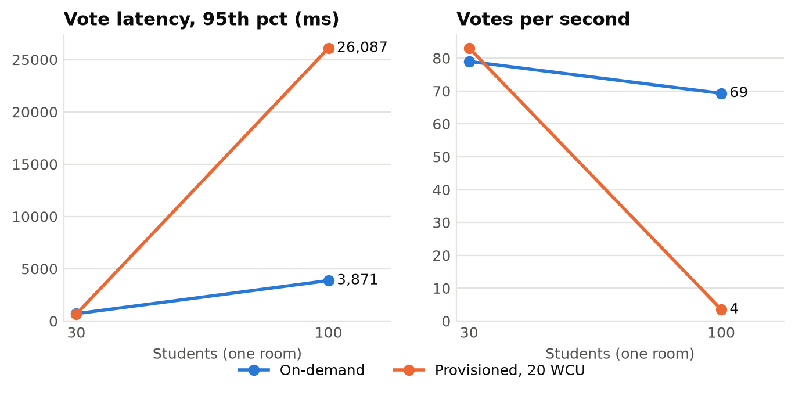
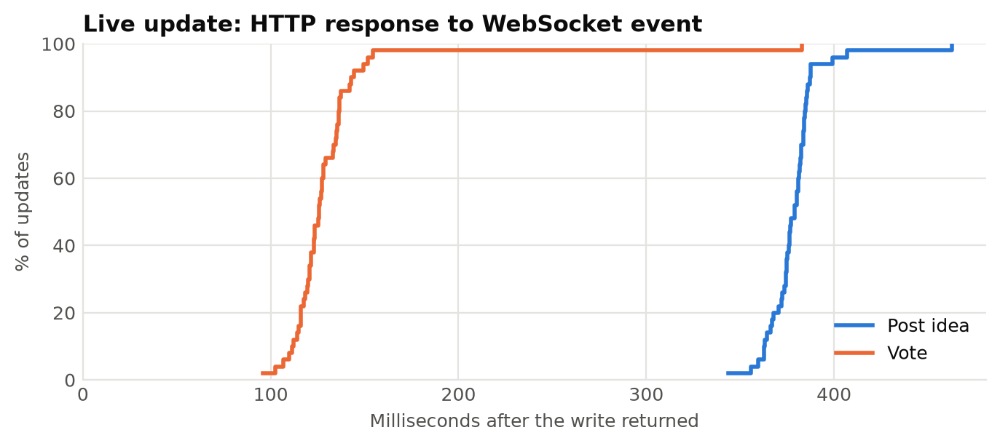
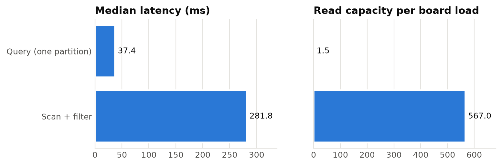

# Benchmark: the brainstorm board under classroom load

This is what we measured for issue #11, how we measured it, and what it means for the design.
`docs/data-model.md` section 5 said we'd measure the hot partition and transaction conflicts
instead of assuming, so this is that. The script is `scripts/benchmark.py`, and every number
here comes from a CSV in `benchmarks/results/` (run ids below). See the README to run it
yourself.

## Short version

- One room is one partition, so a whole class shares it. Against a real table, a busy room
  topped out at about **65-80 votes a second** however many students there were, while the same
  class spread over 10 rooms did **200-350**.
- The limit isn't the 1,000 write units per partition. It's the room's `META` item: every post,
  vote and comment checks it inside its transaction, and two transactions that touch the same
  item at once conflict. At 300 students, almost two thirds of the votes had to be retried and
  4% failed after all five attempts.
- Dropping the room check from votes (open question 3) cut vote conflicts from 1,688 to 16 and
  no vote failed. It's the clearest result we have.
- Nothing was lost. After every scenario, each idea's `vote_count` matched its vote items and
  the votes that succeeded, so the atomic counters held up under contention.
- DynamoDB itself stayed fast: CloudWatch's slowest `TransactWriteItems` in the run took 70 ms.
  The seconds students waited were retries and backoff.
- A live update reached another browser **250-500 ms** after the write was sent.
- Loading a board with a `Query` used 1.5 read units; a `Scan` with a filter used 567 on a
  table with 100 rooms.

## 1. Setup

| | |
|---|---|
| Table | A new one per run (`bench-<run id>`), same schema as the app (`schema.py`), deleted after |
| Region | ca-central-1, on-demand unless it says provisioned |
| Client | One laptop (Linux, 12 CPUs); a single `Query` took about 37 ms round trip |
| Code under test | The app's own data-layer functions (`rooms.py`, `ideas.py`), not copies |
| Runs | `20261126T024200Z` (on-demand), `20261126T024530Z` (provisioned), `20261126T024546Z` (live) |
| Overlap | The live run ran during the provisioned run, on other tables; the laptop was mostly idle then |

The benchmark calls the data layer directly with boto3, not through API Gateway and Lambda. That
leaves out the HTTP hop (about 125 ms, see section 6) and measures what DynamoDB does with the
requests, which is the point here.

### What a student does

Each student is a thread with its own boto3 client. A class goes through these phases, and in
each one every student starts at the same moment (like when the instructor says "go"):

1. **join**: look up the join code, join the room, load the board
2. **post**: post 2 ideas
3. **vote**: vote for 5 of the room's ideas, picked at random
4. **comment**: comment on 1 idea
5. **reload**: load the board again (now with all the ideas and comments)

There's no think time, so this is a stress test, not an average class. A real class spreads the
same actions over minutes.

### Scenarios

| Scenario | What changes |
|---|---|
| `hot-room` | The whole class in one room, so one partition |
| `many-rooms` | The same students and actions spread over 10 rooms |
| `no-room-check` | `hot-room`, but votes don't check the room in their transaction (benchmark only) |
| `hot-idea` | Everyone votes for the same idea at the same moment |
| `query-vs-scan` | Load one board with a `Query` vs a `Scan` of a table holding 100 rooms |

Each runs with 30, 100 and 300 students.

### What we record

For every operation: latency, whether it succeeded, how many HTTP requests it took, how many
transaction conflicts and throttles it hit, and the capacity it used. botocore hooks collect
these, and every request asks for `ReturnConsumedCapacity`. `cloudwatch` then fetches what
DynamoDB counted on its side for the same table and time window.

Two things to keep in mind when reading the numbers:

- Our capacity numbers only count requests that succeeded. A cancelled transaction still uses
  capacity [1], but its error response doesn't say how much. CloudWatch has the true total
  (139k write units for the whole run, about 10 cents).
- Retries are part of the latency, because that's what a student waits for. A vote that
  conflicts is retried up to five times by `transactions.py` with jittered backoff, and a
  throttled request is retried by botocore before that.

### Making sure we measured DynamoDB and not the laptop

Our first AWS run had all students as threads in one Python process. Throughput was stuck at
90-150 operations a second for every class size and the process used a whole core, so Python
(the GIL), not DynamoDB, was the bottleneck and the latencies were mostly time spent waiting in
the client. The benchmark now splits the students over one process per CPU, and each phase
records the busiest process's CPU use (`client_cpu_max` in `-phases.csv`). In the run below it
never went above 0.38 of a core.

## 2. One room vs ten rooms

| Votes | 30 students | 100 students | 300 students |
|---|---|---|---|
| One room, votes/s | 79 | 69 | 66 |
| One room, median / 95th pct (ms) | 91 / 703 | 209 / 3,871 | 204 / 13,658 |
| One room, failed votes | 5 of 150 | 27 of 500 | 57 of 1,500 |
| 10 rooms, votes/s | 198 | 348 | 272 |
| 10 rooms, median / 95th pct (ms) | 78 / 240 | 81 / 363 | 299 / 1,861 |
| 10 rooms, failed votes | 0 | 0 | 3 of 1,500 |

In one room the throughput doesn't grow with the class. More students just means a longer queue
of retries, which is why the median stays around 200 ms but the 95th percentile goes from under a
second to 14 seconds. With 10 rooms, 100 students voted at 348 a second with a 95th percentile
of 363 ms.

The successful votes in the hot room used about 430-515 write units a second, under half the
1,000 per partition that AWS documents [2]. So the room didn't run out of partition capacity:
the votes cancelled each other.

## 3. Transaction conflicts and the room check

Every post, vote and comment is a transaction with a `ConditionCheck` on the room's `META` item
(the room has to be open). DynamoDB cancels a transaction when another transaction is working on
one of the same items at the same time [1]. A condition check counts, even though it doesn't
write. So in one room, every write conflicts with every other write happening at that moment.

| Vote conflicts | 30 | 100 | 300 |
|---|---|---|---|
| One room | 159 | 618 | 1,688 |
| One room, no room check | 8 | 18 | 16 |
| Everyone votes for one idea | 72 | 475 | 1,235 |

Without the room check, votes only touch their own vote item and the idea's counter, and
conflicts almost disappear. No vote failed, and at 300 students the 95th percentile halved. A
vote also gets cheaper: 4.5 write units instead of 6.5, since a transaction pays twice for every
item it touches, and the room is one item fewer. Posts and comments still check the room in this
scenario, and they still conflict.

The trade-off is open question 3: without the check, the API would accept votes after the room
closes, and they'd show up on the closed board. The web client already hides voting in a closed
room, so only someone calling the API directly could do that. For a classroom that's a small
cost, so [TODO: group decision: drop the room check from votes (app change + data-model 4.4), or keep it
and only report it?].

`hot-idea` is the worst case: everyone updates the same counter. The counter item is the hot
spot here, and no change to the room check would help. 14 of 300 votes failed after five
attempts, and the rest took up to 7 seconds. In a real class that's 300 people pressing the same
button within a second, which is unlikely, and the fix would be write sharding [3] (several
counter items per idea, summed on read), which isn't worth it at our size.

## 4. Throttling and the hot partition

From 100 students up, one room also got throttled: 1,003 throttled requests in the 100-student
vote phase and 4,538 at 300, on an on-demand table. CloudWatch counted 46,083 write throttle
events over the whole run. Ten rooms only got throttled at 300 students (1,134).

On-demand doesn't mean unlimited. Every partition still has its limit [2], and on-demand only
scales right away up to what the table has handled before; a brand-new table starts from a
default [4]. Our tables were brand new and the load arrived in one burst, so this is close to
the worst case. We can't see how many partitions a table has, so we can't say exactly which
limit we hit. A single room can never be split across partitions though,
since everything about it shares one partition key.

## 5. Capacity modes

The same `hot-room` class on a table with provisioned capacity: 20 write and 20 read units, the
size `create_table.py --provisioned` uses because it fits in the always-free tier.

| One room, votes | On-demand, 30 | Provisioned, 30 | On-demand, 100 | Provisioned, 100 |
|---|---|---|---|---|
| Votes/s | 79 | 83 | 69 | 3.5 |
| Median / 95th pct (ms) | 91 / 703 | 142 / 672 | 209 / 3,871 | 209 / 26,087 |
| Failed votes | 5 of 150 | 1 of 150 | 27 of 500 | 83 of 500 |

With 30 students the provisioned table did as well as on-demand, even though the class used far
more than 20 units a second. DynamoDB keeps up to 5 minutes of unused capacity as burst capacity
[6], which at 20 units a second is up to 6,000 units. Our brand-new table could use a burst
like that straight away.

With 100 students the burst ran out during the vote phase, and the table dropped to its 20
units: 3.5 votes a second (each costs about 6.5 units), with the whole phase taking 2 minutes
instead of 7 seconds. 83 votes and 17 comments failed after every retry, and one vote in a
hundred waited over a minute. CloudWatch counted 3,082 write throttle events.

So provisioned capacity is cheap and fine for an average class, which spreads its actions over
minutes, but it can't absorb a burst bigger than what it saved up. On-demand handled the same
burst at 20 times the rate, and charged per request for it. That's why the deployed table is
on-demand (open question 1 in `docs/data-model.md`).

## 6. Live updates

Time from the HTTP write to the matching message on a WebSocket subscribed to the room, through
the deployed stack (API Gateway, Lambda, DynamoDB Streams, Lambda, API Gateway). 50 posts and 50
votes, one at a time:

| | HTTP write (median) | Event after the response (median / 95th pct) | Total (median) |
|---|---|---|---|
| Post an idea | 125 ms | 379 / 399 ms | 502 ms |
| Vote | 123 ms | 126 / 152 ms | 250 ms |

All 100 updates arrived. Each vote was sent right after its post's event arrived, and each post
250 ms after the previous vote's event, and the vote's event came about 250 ms sooner. Our guess
is that Lambda reads the stream again right away after finding records and waits longer when it
finds none, but we didn't check that. Either way, a vote shows up on everyone's
board within about a quarter of a second, and an idea within half a second.

Locally, `serve_local.py` polls the stream every 0.2 s, so local live updates take about
150-200 ms after the response.

## 7. Query vs Scan

Loading one board (30 ideas) 20 times each, at the end of the run. By then the table held
15,273 items: 100 rooms of 30 ideas added for this test, plus every earlier scenario's rooms.

| | Median latency | Read units per load |
|---|---|---|
| `Query` on the room's partition | 37 ms | 1.5 |
| `Scan` of the table, filtered to the room | 282 ms | 567 |

A `Scan` reads every item and filters afterwards, and you pay for everything it read [5]. Its
cost grows with the whole table, while a `Query`'s only grows with the room. This is why the app
never scans.

## 8. DynamoDB Local

The same scenarios run on DynamoDB Local, so anyone can reproduce the behaviour without an AWS
account (no lost updates, the same ops and errors). Its numbers don't mean much: it's one Java
process with no partitions, no throttling and, in our runs, no transaction conflicts at all. It
also slowed down about 10x after many runs until we restarted it. Every number in this document
is from AWS.

## References

[1] AWS, "Amazon DynamoDB Transactions: How it works" (Transaction conflict handling, Capacity
management), https://docs.aws.amazon.com/amazondynamodb/latest/developerguide/transaction-apis.html
[2] AWS, "Best practices for designing and using partition keys effectively,"
https://docs.aws.amazon.com/amazondynamodb/latest/developerguide/bp-partition-key-design.html
[3] AWS, "Using write sharding to distribute workloads evenly,"
https://docs.aws.amazon.com/amazondynamodb/latest/developerguide/bp-partition-key-sharding.html
[4] AWS, "DynamoDB on-demand capacity mode" (Initial throughput, peak traffic),
https://docs.aws.amazon.com/amazondynamodb/latest/developerguide/on-demand-capacity-mode.html
[5] AWS, "Scanning tables in DynamoDB,"
https://docs.aws.amazon.com/amazondynamodb/latest/developerguide/Scan.html
[6] AWS, "Burst and adaptive capacity,"
https://docs.aws.amazon.com/amazondynamodb/latest/developerguide/burst-adaptive-capacity.html
